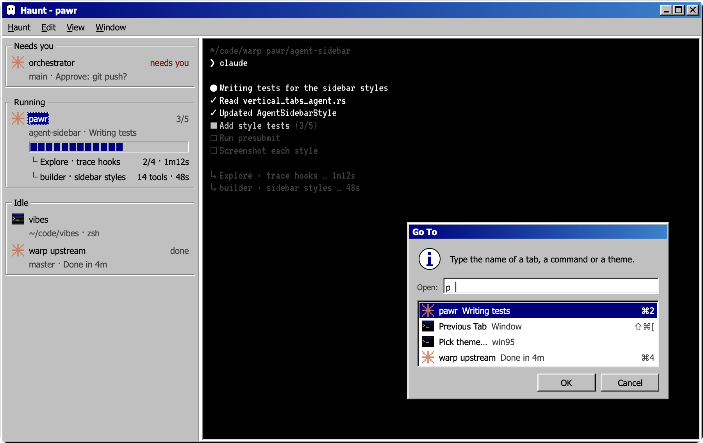

# Windows 95

A Haunt theme of grey bevels. The title bar is a navy caption with a ghost icon and minimise, maximise and close boxes, and a row of Haunt's menus sits under it. The sidebar's groups sit in etched group boxes. Only the selected tab's name is highlighted, progress shows as blocks, and the agent icons are pixel art. The terminal is a black DOS box in VT323. ⌘K opens a "Go To" dialog with OK and Cancel.



## Install and switch

From the repo:

```sh
haunt plugin install .
```

Switch to it from ⌘K ▸ Pick theme…, or set it in `~/.haunt/config.toml`:

```toml
theme = "win95"
```

A copy you install yourself draws only the UI with its fonts, so the terminal falls back to your own monospace font. VT323 draws the terminal only when the theme ships with Haunt.

## Fonts

| Font | Use | Licence |
| --- | --- | --- |
| VT323 | terminal | SIL Open Font License 1.1, [OFL-VT323.txt](OFL-VT323.txt) |
| Tahoma | UI | comes with macOS; not shipped here |

The theme itself is MIT ([LICENSE](LICENSE)).

## Effects

`theme.toml` turns on these `[effects]` keys. Haunt's [themes guide](https://github.com/highskore/haunt/blob/main/docs/themes.md) describes each one.

- Window: `window.square`, `window.frame = "bevel"`, `pane.frame = "bevel"`, `titlebar.style = "caption"`, `titlebar.icon`, `titlebar.menu`, `lights.shape = "boxes"`
- Sidebar: `label.rule = "groupbox"`, `label.case`, `label.weight`, `row.select = "name"`, `row.inset`, `icon.style = "pixel"`, `progress.style = "segments"`, `bar.done`, `needs.weight = "bold"`, `sidebar.footer`
- Palette: `palette.frame = "dialog"`, `palette.inset`, `palette.header`, `palette.font`, `palette.icons`, `palette.selection = "pill"`, `palette.foot`, `palette.scrim`, `palette.keys`, `palette.input.icon`, `palette.tab.sub`

Its `[strings]` word the dialog's caption ("Go To"), its message, the field's label ("Open:") and the subagent prefix ("└ ").
